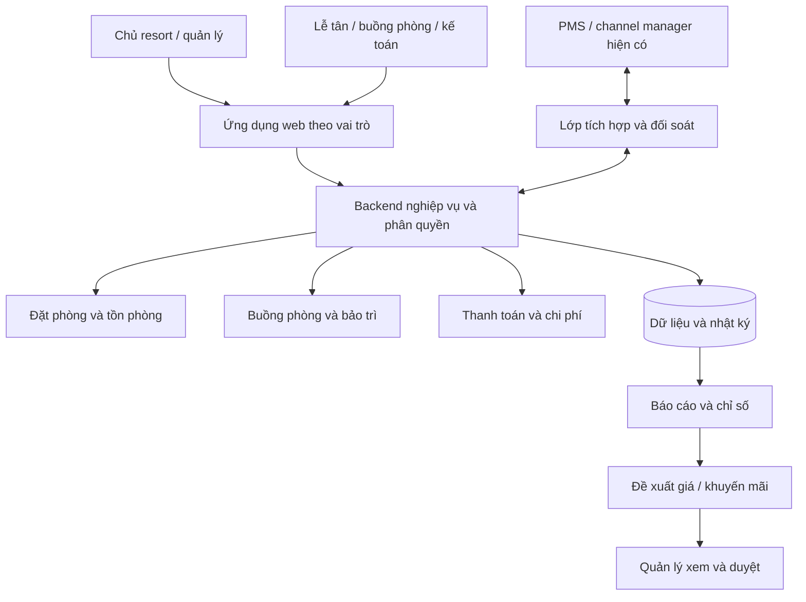

# Tổng quan dự án quản lý resort 100 phòng

**Trạng thái:** thiết kế sản phẩm và xác định nghiệp vụ. Chưa có backend, cơ sở dữ liệu, tích hợp thật hoặc ứng dụng production.

**Kết luận rà soát:** đã có bản đồ tổng quan; chưa khóa thiết kế vận hành. Xem [báo cáo rà soát](docs/DESIGN-REVIEW.md), [sổ quyết định](docs/DECISIONS.md) và [phạm vi từng đợt](docs/IMPLEMENTATION-BRIEF.md) trước khi giao code.

**Chủ dự án:** utne1991. **Nơi lưu:** repository `utne1991/utne1991`, thư mục `resort-management/`.

## Căn cứ lập kế hoạch mới nhất

Người dùng yêu cầu lưu nghiên cứu thị trường ngày 26/10/2026 và dựa vào đó làm việc. [Tóm tắt định hướng](docs/research/MARKET-RESEARCH-WORKING-SUMMARY.md) là điểm bắt đầu, kèm [báo cáo đầy đủ](docs/research/MARKET-RESEARCH-2026-10-26.md), [bản nguyên văn](docs/research/MARKET-RESEARCH-2026-10-26.raw.txt) và [tình trạng bằng chứng](docs/research/MARKET-RESEARCH-SOURCE-REGISTER.md).

Ưu tiên lập kế hoạch **Operations & Revenue Control Layer kết nối PMS/channel manager hiện có**, pilot một resort, một nguồn booking/tồn chính và một connector. Luồng discovery/baseline → đọc/đối soát → ops/agency → revenue có duyệt → ghi có kiểm soát khi đủ điều kiện. Chưa chọn nhà cung cấp hoặc khẳng định resort đã có PMS; chưa phê duyệt giá, entitlement API, ngân sách hoặc baseline triển khai.

Các phần chín phân hệ, ERD và full PMS bên dưới được giữ làm thư viện thiết kế dài hạn. Chúng không tự trở thành scope v1 sau khuyến nghị thị trường mới. Đọc lại ownership và giới hạn ghi trước khi giao code; không tạo inventory/folio song song với PMS nguồn chính.

**Audit 002:** [gói thiết kế bổ sung](docs/TASK-RESORT-DESIGN-AUDIT-002.md) có wireframe local chín phân hệ/bốn mobile view, form mẫu, bảy blueprint và benchmark mã PMS. Figma được người kiểm toán báo cáo có 16 frame; Codex chưa có node/version để đối chiếu. Các đầu ra vẫn là bản nháp, không có baseline hoặc backend đã duyệt.

**Phạm vi thiết kế cập nhật 26/10/2026:** toàn bộ PMS chín phân hệ, không chỉ dashboard. Xem [mô hình vận hành resort](docs/RESORT-OPERATING-MODEL.md), [đặc tả màn hình](docs/SCREEN-SPECIFICATIONS.md) và [bảng bao phủ](docs/SCREEN-COVERAGE.md). Repo có dashboard cũ và wireframe bổ sung; Figma/FigJam vẫn được theo dõi độc lập ở [tiếp nhận thiết kế](docs/FIGMA-HANDOFF.md). SaaS/profile dịch vụ là [phương án mở rộng chưa chốt](docs/BEESMART-PRODUCT-OPTIONS.md).

## 1. Mục tiêu kinh doanh

Xây dựng một ứng dụng web để người quản lý trả lời nhanh:

1. Phòng nào đang có khách, sắp trả và sẵn sàng nhận khách mới?
2. Ngày nào còn nhiều phòng chưa bán, thuộc loại phòng nào?
3. Cần ưu tiên dọn phòng, bảo trì hay xử lý đặt phòng nào?
4. Kênh bán, mức giá và chương trình khuyến mãi nào mang lại lợi nhuận tốt hơn sau chi phí?

Tăng công suất phải đi cùng hiệu quả kinh doanh. Không đặt mục tiêu bán kín bằng mọi giá; không cam kết phần mềm hoặc AI bảo đảm lấp đầy resort.

## 2. Người sử dụng

| Vai trò | Nhu cầu chính |
| --- | --- |
| Chủ resort / quản lý | Tổng quan, lịch bán, doanh thu, chi phí, duyệt giá và chiến dịch |
| Lễ tân | Đặt phòng, khách đến/trả, gán/đổi phòng, đặt cọc và thanh toán theo quyền |
| Buồng phòng | Danh sách công việc, ưu tiên phòng có khách đến, cập nhật dọn và kiểm tra |
| Bảo trì | Nhận việc, chặn phòng theo thời gian, bàn giao phòng |
| Kế toán / kinh doanh | Đối soát, chi phí kênh, hiệu quả bán và chiến dịch theo quyền |

Mỗi vai trò chỉ xem và thao tác dữ liệu cần thiết. Phân quyền phải được thực thi ở backend khi triển khai, không chỉ ẩn nút trên giao diện.

## 3. Các phân hệ dự kiến

| Phân hệ | Kết quả cần đạt | Ưu tiên |
| --- | --- | --- |
| Dashboard | Biết tình hình hôm nay và việc cần xử lý | Giai đoạn giao diện đầu tiên |
| Lịch phòng | Xem khả dụng theo ngày, loại phòng và phòng vật lý | Nghiệp vụ cốt lõi |
| Đặt phòng | Booking nhiều phòng, nhận/trả, thay đổi/hủy, tránh bán trùng | Nghiệp vụ cốt lõi |
| Khách và yêu cầu | Khách/đầu mối đoàn, công việc phục vụ có người nhận và hạn | Nghiệp vụ cốt lõi theo quyền |
| Buồng phòng và bảo trì | Phân biệt khách đã trả với phòng thực sự sẵn sàng | Nghiệp vụ cốt lõi |
| Tài chính vận hành | Đặt cọc, thanh toán, hoàn tiền, đối soát | Nghiệp vụ cốt lõi; chi tiết cần xác nhận |
| Kết nối kênh bán | Nhận booking và đồng bộ tồn/giá qua tích hợp được hỗ trợ | Trước vận hành đa kênh |
| Báo cáo | Công suất, ADR, RevPAR, phí kênh và lợi nhuận đóng góp | Sau khi dữ liệu nền đáng tin cậy |
| Giá và khuyến mãi | Đề xuất có căn cứ, có giới hạn và người duyệt | Sau báo cáo |
| Quảng cáo và dự báo nâng cao | Đo hiệu quả tăng thêm, dự báo được đánh giá trên dữ liệu thật | Giai đoạn sau |

## 4. Sơ đồ tổng thể

Nếu resort đã có PMS, cần quyết định hệ thống nào giữ dữ liệu đặt phòng và tồn phòng chính trước khi triển khai. Không xây hai nguồn tồn phòng độc lập.

## 5. Dashboard đã thiết kế

Thứ tự nội dung:

1. Cơ sở, ngày kinh doanh, vai trò và trạng thái cập nhật dữ liệu.
2. Cảnh báo khách sắp đến nhưng phòng chưa sẵn sàng.
3. Công suất hiện tại, phòng sạch trống, số phòng trả hôm nay, lượng phòng đã đặt D+7.
4. Công việc sắp trả / sắp đến / cần dọn.
5. Sơ đồ trạng thái 100 phòng và bộ lọc.
6. Lượng phòng đã đặt trong 7 ngày tới.
7. Đề xuất doanh thu có người duyệt.
8. Hiệu quả kênh sau hoa hồng, quảng cáo và chi phí phục vụ.

[Bản HTML](design/dashboard.html) có tương tác lọc phòng, chuyển nhóm công việc và mở chi tiết mẫu. Điều hướng và các thao tác nghiệp vụ còn là điểm thiết kế, chưa kết nối hệ thống thật.

## 6. Những nguyên tắc không được làm sai

- Booking tương lai là dữ liệu đã biết; dự báo nhu cầu là ước lượng. Phải ghi nhãn khác nhau.
- Phòng khách vừa trả chưa chắc đã sạch và có thể bán ngay.
- Phòng vật lý, loại phòng và lượt đặt phòng là các đối tượng khác nhau.
- Công suất báo cáo dùng số đêm phòng có thể bán làm mẫu số; phải công bố cách tính phòng bảo trì.
- Lợi nhuận đóng góp sau chi phí biến đổi chưa phải lợi nhuận ròng toàn resort.
- Thay đổi giá, ngân sách quảng cáo và giao dịch tài chính cần quyền hạn, nhật ký và cơ chế kiểm soát.
- Không dùng dữ liệu khách thật hoặc secrets trong repo, ảnh mẫu và dữ liệu demo.

Chi tiết công thức và trạng thái nằm trong [PRODUCT-MAP](docs/PRODUCT-MAP.md).

## 7. Lộ trình và điều kiện chuyển bước

| Bước | Công việc | Điều kiện hoàn thành |
| --- | --- | --- |
| S0–S1 — Hiện tại | Tổng quan, sơ đồ, dashboard HTML mẫu và rà soát | Có tài liệu chung; kiểm tra trình duyệt Archify còn vướng môi trường |
| S2 — Chốt phạm vi | Xác nhận thiết kế và quyết định cho đợt cần làm | Ghi baseline, người xác nhận và các giả định còn mở |
| S3a — Dashboard demo | Chuyển dashboard thành app dùng dữ liệu giả | Có PR, chạy được, kiểm tra responsive và số liệu |
| S3b — Lịch/booking demo | Đợt UI riêng sau dashboard | Có hợp đồng dữ liệu, lịch theo ngày và xử lý xung đột demo |
| S3c — Vận hành/khách demo | Buồng phòng, bảo trì và yêu cầu khách | Dùng chung fixture, bàn giao giữa bộ phận và trạng thái nhất quán |
| S3d — Kinh doanh/cấu hình demo | Thu chi, giá/gói/chiến dịch, báo cáo và cấu hình mẫu | Định nghĩa tiền/chỉ số/quyền rõ; không giao dịch thật |
| S4 — Backend nghiệp vụ | Đăng nhập, booking, tồn phòng, dọn phòng, quyền và nhật ký | Chốt D01–D07; kiểm thử chồng lịch/đặt đồng thời, quyền, sao lưu/khôi phục |
| S5 — Kết nối và chạy thử | PMS/kênh bán, đối soát, quy trình vận hành | Dữ liệu khớp; xử lý lỗi đồng bộ và có phương án quay lui |
| S6 — Tối ưu doanh thu | Báo cáo thật, giá/khuyến mãi có người duyệt | Chỉ số đối soát được, đo kết quả và chi phí |
| S7 — AI tùy chọn | Trợ lý chỉ đọc trước, đánh giá chất lượng | Dữ liệu theo quyền, câu trả lời có căn cứ và chi phí được kiểm soát |

Chưa giao việc cho Claude, chưa ấn định ngân sách hoặc lịch hoàn thành khi chưa biết hệ thống hiện tại và phạm vi tích hợp.

## 8. Lựa chọn kỹ thuật đang đề xuất, chưa chốt

- Giao diện: Next.js + TypeScript, Tailwind, Recharts nếu bắt đầu app mới. Theo framework sẵn có nếu chọn mở rộng một hệ thống.
- Backend và cơ sở dữ liệu: quyết định sau khi xác nhận PMS, luồng đặt phòng và yêu cầu vận hành. PostgreSQL là một lựa chọn để đánh giá, chưa phải cấu hình đã cài.
- GitHub: lưu thiết kế, mã nguồn, issue và PR trong thư mục dự án hiện tại.
- Môi trường production: hosting riêng có HTTPS, cơ sở dữ liệu, sao lưu và giám sát. Codex Cloud là nơi phát triển; chưa có dịch vụ chạy liên tục cho resort.
- MCP: chưa cần cho bước thiết kế. GitHub/Figma/Playwright có thể bổ sung theo công cụ và quyền truy cập thực tế.

## 9. Thông tin cần thu thập trước khi code nghiệp vụ

- Resort hiện dùng PMS hoặc channel manager nào? Có API/export dữ liệu không?
- Danh sách 100 phòng, loại phòng, giá, thời gian nhận/trả và chính sách bảo trì.
- Các kênh bán, phí kênh, quy trình khách đoàn và nguồn booking trực tiếp.
- Quy trình đặt cọc, thu tiền, hủy/hoàn và cách tính thuế/phí.
- Vai trò nhân viên, thiết bị dùng tại quầy và trong buồng phòng.
- Dữ liệu chi phí và lịch sử booking có thể sử dụng hợp lệ.
- Ngân sách vận hành, hosting và yêu cầu bảo vệ/lưu trữ dữ liệu khách.

Các câu hỏi này không chặn việc xem và chỉnh bản thiết kế hiện tại; chúng chặn quyết định backend và vận hành thật.

## 10. Tài liệu và cách làm việc tiếp theo

- [Hướng dẫn Claude đọc dự án](CLAUDE.md)
- [Các bước thực hiện và trạng thái](docs/IMPLEMENTATION-STEPS.md)
- [Danh mục sơ đồ theo từng câu hỏi](docs/diagrams/README.md)
- [Vai trò và snapshot Archify, ECC, Hello-Agents](docs/TOOLING-AND-SOURCES.md)
- [Sáu sơ đồ tương tác Archify](docs/diagrams/exports/index.html) và [bằng chứng kiểm tra](docs/diagrams/VERIFICATION.md)
- [Quy trình dùng Archify trong cloud](docs/ARCHIFY-WORKFLOW.md)
- [Bắt đầu và công cụ](README.md)
- [Bản đồ màn hình, nghiệp vụ và dữ liệu](docs/PRODUCT-MAP.md)
- [Bản mẫu dashboard](design/dashboard.html)
- [Hướng dẫn bàn giao cho Claude khi chủ dự án quyết định triển khai](docs/CLAUDE-HANDOFF.md)

Trước mắt tiếp tục hoàn thiện thiết kế và chốt phạm vi. Bản hướng dẫn Claude là tài liệu dự phòng, không phải thông báo đã giao hoặc đã hoàn thành code.
