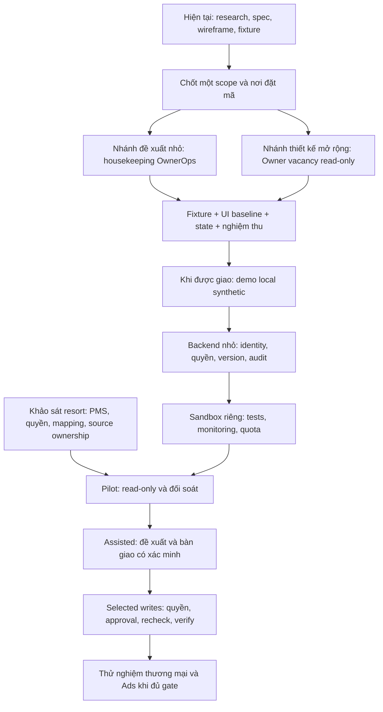

# Bản đồ chỉ dẫn triển khai BeeSmart HotelOS

Ngày 26/10/2026. **Bản đồ kế hoạch, chưa là lệnh code hoặc baseline được duyệt.** Đọc [mức sẵn sàng](IMPLEMENTATION-READINESS.md), [trạng thái chung](../PROJECT-STATUS.md) và [DECISIONS](DECISIONS.md) trước. Báo cáo mới được [lưu đầy đủ](research/OWNER-CONTROL-HIGH-FIDELITY-2026-10-26.md).

## Đi từ đâu đến đâu?

Hai nhánh scope là lựa chọn để xem xét, không phải quyết định đã chốt hoặc phải làm đồng thời. Khảo sát resort có thể làm song song với thiết kế; credentials PMS không chặn demo synthetic. Backend/auth phải có trước sandbox có người dùng đăng nhập.

## Tài liệu nào chỉ dẫn phần nào?

| Câu hỏi triển khai | Đọc ở đâu | Đầu ra còn cần |
| --- | --- | --- |
| Sản phẩm làm gì, ưu tiên gì? | [Market summary](research/MARKET-RESEARCH-WORKING-SUMMARY.md), [OwnerOps assessment](OWNEROPS-ASSESSMENT.md) | Scope MVP do chủ dự án chọn |
| Một luồng nhỏ và các quyền/state? | [OwnerOps MVP contract](OWNEROPS-MVP-CONTRACT.md), [fixture](../design/fixtures/ownerops-pilot-scenarios.json) | Chốt D03/D07/D14, baseline UI và nơi code |
| Owner thấy phòng trống và quyết định thế nào? | [Nghiên cứu mới](research/OWNER-CONTROL-HIGH-FIDELITY-2026-10-26.md), [review/công thức](IMPLEMENTATION-READINESS.md), [B07](blueprints/07-revenue-approval.md) | Một bộ fixture nhất quán, view/action contract và giới hạn read-only |
| Tổng thể PMS và các hành trình liên quan? | [Operating model](RESORT-OPERATING-MODEL.md), [9 screen specs](SCREEN-SPECIFICATIONS.md), [coverage](SCREEN-COVERAGE.md) | Chỉ chọn phần liên quan MVP; không tự code toàn thư viện |
| Dữ liệu, booking/inventory, tiền, sync/quyền? | [7 blueprint](blueprints/README.md), [quy tắc](OPERATING-RULES.md) | Schema/API/transaction và mapping nguồn thật theo scope |
| Giao Claude gì? | [CLAUDE-HANDOFF](CLAUDE-HANDOFF.md) | Hiện là prompt rà soát; lệnh code tương lai ghi scope/repo/mức A–B–C |
| Host, giám sát, restore, phát hành? | [Pilot/observability review](PILOT-OBSERVABILITY-REVIEW.md), [release/recovery](diagrams/10-release-and-recovery.md) | Target/budget/quyền, kiểm thử và runbook thật |
| Có ảnh/sơ đồ để xem chưa? | [Wireframes](../design/pms-wireframes.html), [Figma handoff](FIGMA-HANDOFF.md), [Archify](diagrams/README.md) | High-fidelity/version/visual acceptance còn thiếu |

## Đối chiếu các hành trình trong nghiên cứu mới

ID OWN-/MGR-/HK-/MNT-/FD- dưới đây là **ID đề xuất trong báo cáo**, chưa là frame đã tồn tại/xuất ảnh hoặc route app.

| Journey | Chuỗi được đề xuất | Nền đã có | Phần còn thiếu trước khóa |
| --- | --- | --- | --- |
| A — Owner vacancy → kết quả | OWN-01 → 03 → 05 → 06 → 10/11 → 18 → 20 → 22 | KPI/room rules, revenue blueprint, UI07 wireframe | Fixture date/type, diagnosis evidence, comparator, approval/execution/results UI và source contract |
| B — Maintenance → khôi phục tồn | OWN-25/27 → MGR-03 → MNT-01/02/03 → QA → nguồn xác nhận | Service ops + sync/room block blueprint | Block ownership, QA/reviewer, occupied/conflict handling, PMS capability và verify; accepted không tự mở bán |
| C — Housekeeping → rework → accepted | MGR-03 → HK-01/02/04 → MGR-04 → HK-05 → review | OwnerOps contract + fixture submit/rework/revision/accept | Chốt UI/policy, demo state engine; ảnh HK-03 thật chưa thuộc thử đầu; ready do nguồn quyết định |
| D — Package → duyệt → publish | OWN-05 → 13/14 → 10 → 18 → 20 | B07 approval/guardrails, UI07 | Chi phí gói/giá, revision/expiry, quyền publish và verify; chưa giao implementation |
| E — Ads → stop → kết quả | OWN-17 → 18/19 → 20/21 → 22 | Định hướng người duyệt và contribution | Booking path, quyền Ads, attribution/baseline, spend delay/buffer/pause verification; chưa có ngân sách |

## Đề xuất chia phần công việc

| Thứ tự | Gói việc để xem xét | Điểm dừng trước khi chuyển tiếp |
| --- | --- | --- |
| 0 | Chọn scope/demo, fixture, policy và repo đích | Không bắt đầu framework khi mới được giao đánh giá |
| 1 | Baseline UI nhỏ cho Journey C hoặc phần read-only của A; mobile/states | Chưa gọi là full high-fidelity 46+ màn hoặc Figma đã đồng bộ |
| 2 | Khi được giao: demo synthetic, reset, happy/error/rework/conflict | Không gọi role switch là auth hoặc adapter fake là connector thật |
| 3 | Backend nhỏ theo OBS-00/01/02/03/04/05 | Server isolation/transaction/audit và CI thực; fixture không tự là tests pass |
| 4 | Sandbox OBS-06 và pilot OBS-07 | Hạ tầng được chỉ định; source quyền thật; restore/support và release gate |
| 5 | Bổ sung revenue theo bằng chứng và capability | Read/reconcile trước, assisted trước writes; Ads có gate riêng |

Các gói trên ánh xạ backlog có sẵn, không tạo thêm lệnh tự triển khai hoặc lịch cam kết. OBS-* vẫn chưa được giao. SaaS billing/full PMS/direct OTA không tự nhập vào scope vì có trong nghiên cứu.

## Gói bàn giao trước khi code

- Scope/role/property/repo và một journey được giao rõ, cùng phần loại trừ.
- Source UI hoặc frame/node/version đã chọn; fixture ID và asOf thống nhất, trạng thái thiếu/trễ/lỗi/mất quyền.
- Action/permission/state/revision/idempotency và source ownership theo scope; backend có contract cụ thể hơn demo.
- Acceptance có thể chạy; ghi riêng kiểm tra đã thực hiện và kiểm tra tương lai.
- Sandbox/pilot mới cần target, quyền, chi phí, nguồn PMS/retention/restore/support; demo local không cần mua VPS.

**Đã có bản đồ chỉ dẫn. Chưa đủ để triển khai toàn bộ sản phẩm hoặc go-live.** Phần còn thiếu phải được hoàn thiện theo gói nhỏ, không chờ tích lũy thêm báo cáo chung.
