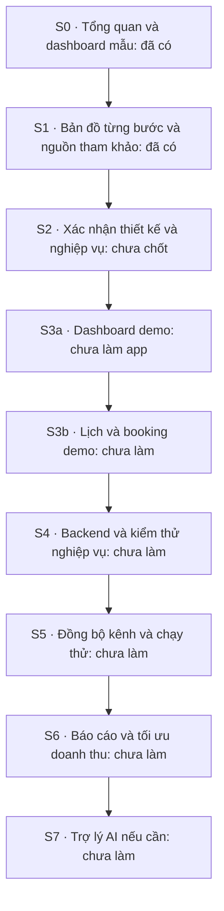

# Từng bước thực hiện

Đây là bảng trạng thái chung. Sơ đồ thể hiện **trình tự dự kiến**, không có nghĩa các bước đã được triển khai hoặc được chủ dự án duyệt.

Đọc [kết quả rà soát trước khi khóa](DESIGN-REVIEW.md). Baseline chưa được xác nhận; các quyết định ở [DECISIONS](DECISIONS.md). S3 tách thành S3a dashboard và S3b lịch/booking demo theo [phạm vi giao việc](IMPLEMENTATION-BRIEF.md).

| Bước | Trạng thái | Đầu vào / công việc | Đầu ra và kiểm tra |
| --- | --- | --- | --- |
| S0 | Có bản nháp | Tổng quan, PRODUCT-MAP, HTML dashboard | Có file; đã kiểm tra cú pháp JS và phép tính mẫu; chưa kiểm tra giao diện trong trình duyệt |
| S1 | Có tài liệu và HTML Archify; kiểm tra trình duyệt còn vướng | Danh mục ba nguồn, sơ đồ nghiệp vụ, hướng dẫn đọc | Sáu HTML đã đạt validate/deliver/strict check; browser-check lỗi môi trường, chưa duyệt trực quan. Xem [bằng chứng](diagrams/VERIFICATION.md) |
| S2 | Chưa chốt | Xem bản mẫu; xác nhận PMS, kênh bán, loại phòng, vai trò, giá/thuế và phạm vi ưu tiên | Ghi quyết định của chủ dự án và các giả định còn mở; ảnh/bố cục được rà soát |
| S3a | Chưa làm app | Dashboard và tương tác theo CLAUDE-HANDOFF; không gồm lịch đầy đủ | App demo có hướng dẫn chạy, kiểm tra responsive, build/typecheck và PR |
| S3b | Chưa làm | Chốt lịch/form rồi làm đợt demo riêng | Lịch theo ngày, booking mẫu và xử lý xung đột; chưa kết nối dịch vụ thật |
| S4 | Chưa làm | Quyết định nguồn booking/tồn phòng chính và mô hình dữ liệu | Booking, quyền, dọn phòng, thanh toán theo phạm vi; kiểm thử đặt đồng thời, chồng lịch, quyền và khôi phục dữ liệu |
| S5 | Chưa làm | Tích hợp được cấp quyền, quy tắc đồng bộ/đối soát | Không mất/trùng sự kiện, phát hiện dữ liệu trễ, đối soát booking/tồn; có kế hoạch quay lui khi chạy thử |
| S6 | Chưa làm | Dữ liệu doanh thu và chi phí đã đối soát | Chỉ số đúng, đề xuất có căn cứ, giới hạn và người duyệt; chưa tự chi quảng cáo |
| S7 | Tùy chọn, chưa làm | Có nhu cầu và tiêu chí đánh giá AI; xác minh quyền dùng nguồn | Trợ lý đọc dữ liệu theo quyền, trả lời có căn cứ; đo độ đúng và chi phí trước khi thêm hành động |

## Cách đọc sơ đồ theo bước

1. [Danh mục sơ đồ](diagrams/README.md): mở bản đồ phù hợp câu hỏi.
2. [Màn hình](diagrams/01-screen-map.md): ai dùng, đi tới đâu.
3. [Booking và dọn phòng](diagrams/02-booking-workflow.md): nghiệp vụ hoạt động thế nào.
4. [Kiến trúc](diagrams/03-system-architecture.md): dữ liệu đi qua hệ thống nào.
5. [Mô hình dữ liệu](diagrams/04-data-model.md): các đối tượng liên quan ra sao.
6. [Giá, khuyến mãi và AI](diagrams/05-revenue-workflow.md): khi nào đề xuất, khi nào được thực thi.

## Quy tắc cập nhật tiến độ

Sau mỗi bước, cập nhật đúng dòng với commit/PR, lệnh kiểm tra và kết quả hoặc tài liệu quyết định liên quan. Không dùng “đã xong” cho phần mới viết prompt. Không đánh dấu công cụ đã cài nếu chỉ đọc hướng dẫn. Khi thay đổi nghiệp vụ, sửa PRODUCT-MAP và sơ đồ liên quan trong cùng thay đổi.

Tài liệu lộ trình này chưa tạo GitHub Issues/Projects, chưa gửi thông báo hay giao việc cho Claude.
