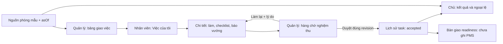

# OwnerOps — đặc tả MVP để chốt trước khi code

Ngày: 26/10/2026. **Bản thảo đề xuất, chưa khóa scope hoặc giao code.** Căn cứ: [market summary](research/MARKET-RESEARCH-WORKING-SUMMARY.md), [OwnerOps assessment](OWNEROPS-ASSESSMENT.md), [review PR #1](PILOT-OBSERVABILITY-REVIEW.md), [fixture synthetic](../design/fixtures/ownerops-pilot-scenarios.json). Chỉ thị hiện hành là đánh giá/lưu kế hoạch.

Tài liệu gom NEXT-01 thành một luồng có thể đánh giá, không thay [DECISIONS](DECISIONS.md), schema/API được duyệt hoặc Figma.

## 1. Phạm vi thử đầu đề xuất

Một resort 100 phòng, một bộ phận housekeeping, ba góc nhìn: chủ xem ngoại lệ; quản lý giao/nghiệm thu; nhân viên làm/nộp. Giả thuyết cần thử là giảm bỏ sót/chờ kiểm tra và giúp chủ truy nguyên tình trạng nhanh hơn; chưa có số đo chứng minh.

| Trong đề xuất thử đầu | Quyết định riêng hoặc để sau |
| --- | --- |
| Phòng mẫu; task/checklist, người giao/làm/duyệt, hạn và lịch sử | Booking engine, OTA/channel manager, thanh toán/hoàn/hóa đơn |
| Giao → làm → nộp → làm lại → nộp lại → nghiệm thu | Tự ghi PMS/mở tồn bán, tự chi ads/đổi giá |
| Owner dashboard từ cùng task, nguồn phòng và asOf | Finance/profit đầy đủ, payroll, billing SaaS/portfolio |
| Mobile web cho việc của tôi, báo vướng, xem kết quả | Offline sync/PWA/push, camera/ảnh thật, chatbot tự xử lý |
| Fake adapter, synthetic data và reset demo | Connector thật, dữ liệu khách/agency/tour thật |

100 là quy mô danh mục phòng, không phải mỗi phòng bắt buộc có task mỗi ngày. Task chỉ tạo từ trigger hợp lệ hoặc thao tác quản lý có audit. Demo bắt đầu bằng task đã giao như fixture; không giả vờ đã nhận webhook checkout.

## 2. Bản đồ màn hình

| View | Nội dung và tương tác |
| --- | --- |
| O1 — Tổng quan chủ | Chờ review, quá hạn, blocked, kết quả theo kỳ, nguồn/asOf; bấm KPI đến danh sách đúng bộ lọc và lịch sử |
| M1 — Bảng vận hành | Việc theo người/trạng thái/phòng/hạn/reviewer; giao/chuyển việc, đổi hạn có lý do, mở chi tiết |
| M2 — Hàng chờ review | Submission hiện hành, checklist, lịch sử; duyệt/làm lại có lý do; conflict phải tải lại |
| W1 — Việc của tôi | Việc được giao và hạn; bắt đầu/mở chi tiết; không xem tiền hoặc việc ngoài scope |
| W2 — Chi tiết việc | Checklist, ghi chú mẫu, revision, kết quả review; nộp/báo blocked/tiếp tục/nộp lại, retry chống trùng |
| H1 — Lịch sử | Actor/action/time/version và review mỗi revision; chỉ đọc, không sửa lịch sử bằng form |

Các view dùng chung dữ liệu, không phải sáu app/PR riêng. Chuyển role trong demo chỉ đổi góc nhìn; backend phải kiểm tra session/membership/quyền tại server.

Mỗi view có loading/empty/error/stale/denied phù hợp. Gửi lỗi giữ draft, báo chưa ghi nhận; không báo thành công trước kết quả. Viewport mục tiêu 390/768/1024/1440px; nhãn/focus/bàn phím rõ. Đây là yêu cầu kiểm tra tương lai, chưa nghiệm thu giao diện.

## 3. Quyền đề xuất

Mọi quyền giới hạn tenant/property/resource và membership còn hiệu lực. Chủ không mặc nhiên là reviewer.

| Hành động | Chủ | Quản lý/reviewer | Nhân viên |
| --- | --- | --- | --- |
| Xem vận hành | Property được cấp | Bộ phận/property được cấp | Việc được giao |
| Tạo/giao/chuyển/hủy | Cấp riêng | Theo scope, lý do và state | Không |
| Checklist/bắt đầu/nộp/báo vướng | Không mặc định | Khi là assignee | Khi là assignee hiện hành |
| Duyệt/làm lại | Cấp reviewer riêng | Reviewer hợp lệ, không duyệt việc mình làm | Không |
| Đổi hạn/reviewer | Cấp riêng | Quyền riêng, giữ lịch sử | Không |
| Tiền/export/minh chứng | Quyền dữ liệu riêng | Quyền dữ liệu riêng | Không mặc định |

Quản lý kiêm người làm cần reviewer khác đủ quyền; thiếu người thì giữ chờ review và báo ngoại lệ. Nhân viên báo vướng trong task của mình; báo sự cố ngoài task cần policy riêng.

## 4. Chuyển trạng thái đề xuất

Hàng review là task `SUBMITTED`, chưa cần state `IN_REVIEW`. `ACCEPTED`/`CANCELLED` kết thúc; draft form trước khi giao chưa là task trong workflow.

| Từ | Action → đến | Actor/điều kiện |
| --- | --- | --- |
| ASSIGNED | start → IN_PROGRESS | Assignee hiện hành |
| IN_PROGRESS | block → BLOCKED | Assignee, có lý do |
| BLOCKED | resume → IN_PROGRESS | Assignee, ghi cách xử lý |
| IN_PROGRESS | submit → SUBMITTED | Checklist đủ theo template; tạo revision mới bất biến |
| SUBMITTED | review_rework → REWORK | Reviewer hợp lệ, đúng version/revision, có lý do |
| REWORK | resume → IN_PROGRESS | Assignee; giữ submission/review cũ |
| SUBMITTED | review_accept → ACCEPTED | Reviewer hợp lệ, đúng version/revision, không tự duyệt |
| ASSIGNED / IN_PROGRESS / BLOCKED / REWORK | cancel → CANCELLED | Quản lý đủ quyền, có lý do; không xóa lịch sử |

Đề xuất không hủy/chuyển assignee/đổi template khi `SUBMITTED`: xử lý qua review trước; chuyển người sau rework phải rõ trách nhiệm. Task accepted cần sửa sai bằng việc liên kết mới, không âm thầm mở lại. Reviewer có thể thay bằng người đủ quyền, có lý do/audit và tăng version. Các quy tắc này cần xác nhận ở D07/D14.

Mọi mutation có expected task version; tăng đúng một lần khi commit, không tăng khi denied/conflict/retry cùng kết quả. Review tham chiếu task version và submission revision. Hai review tranh cùng version: tối đa một quyết định commit. Đổi người/hạn/reviewer cũng tăng version và audit.

Idempotency key scope theo tenant/property/task/action/actor và fingerprint payload: cùng key/payload trả kết quả cũ, không tạo thêm audit/submission; cùng key khác payload báo conflict. Server kiểm tra quyền hiện hành trước trả dữ liệu retry. TTL key, HTTP status và transaction strategy chốt khi thiết kế API; chưa có implementation.

## 5. Dữ liệu và nguồn ghi

| Nhóm | Trường tối thiểu cần mô tả | Nguồn ghi đề xuất |
| --- | --- | --- |
| Identity/scope | tenant, property, actor, membership, permission | Identity được chọn; demo dùng actor synthetic |
| Phòng | ID/number, occupancy, housekeeping, block, source, observedAt, lastSuccessfulSyncAt | Fake adapter demo; PMS/CM được chỉ định khi pilot |
| Task | ID/scope/resource, sourceEventId nếu có, assignee/reviewer, state/version, checklistTemplateVersion, dueAt | Work engine local trong scope được duyệt |
| Submission | task ID, revision, checklist snapshot, submittedBy/At | Work engine; bất biến sau nộp |
| Review/audit | revision, decision/reason, actor/time, expected/new version | Work engine; append, không sửa lịch sử |
| Tiền | kỳ/nguồn/asOf, revenue/collection/deposit/cost/coverage | Chưa thuộc thử đầu; cần thiết kế nguồn/nhãn khi thêm |

Event tạo task cần uniqueness theo source/scope/event. Sự kiện cũ được sửa/rút lại phải đối soát, không tự xóa task hoặc kết luận khách đã trả. Thử đầu không tạo event thật.

Task accepted chỉ xác nhận công việc được nghiệm thu. Phòng nhận khách còn tùy occupancy, QA, block, freshness và nguồn PMS. Không có PMS write thì chỉ bàn giao/chờ xác nhận; gửi request thành công chưa là PMS acknowledgment.

Múi giờ mẫu Asia/Ho_Chi_Minh, timestamp ISO 8601 có offset, kỳ theo property. Freshness threshold chưa chốt; thiếu cấu hình/nguồn không ghi “live”. Demo dùng asOf cố định để chạy lại kịch bản; không dùng nguồn stale để suy đoán tồn hiện tại.

## 6. KPI đề xuất

Chọn cohort **task có dueAt trong kỳ**, tại một mốc asOf; loại cancelled khỏi mẫu số nhưng hiển thị riêng số hủy. Dùng dueAt hiện hành và giữ lịch sử đổi hạn; hiển thị số task đã đổi hạn để không che việc dời deadline. Kỳ đã công bố lưu snapshot/asOf. Policy cần xác nhận trước dùng đánh giá nhân sự.

| Chỉ số | Định nghĩa |
| --- | --- |
| Chờ review | Số task SUBMITTED tại asOf; thời gian chờ từ submission hiện hành |
| Quá hạn chưa nghiệm thu | Task chưa kết thúc có dueAt < asOf, gồm làm/chờ review/rework/blocked, phân nhóm nguyên nhân |
| Nộp lần đầu đúng hạn | Trong cohort có dueAt ≤ asOf: task có firstSubmittedAt ≤ dueAt / tổng task đến hạn không hủy; chưa nộp vẫn trong mẫu số |
| Nghiệm thu đúng hạn | Cùng mẫu số task đến hạn: acceptedAt ≤ dueAt / tổng; không quy toàn bộ chậm review thành lỗi nhân viên |
| Đạt ngay lần đầu | Task accept revision 1 chưa từng rework / task đã có review quyết định lần đầu trong cohort; hiển thị riêng chưa review, không bỏ rework chưa nộp lại khỏi mẫu số |
| Thời gian chờ review | Từng lượt submit → quyết định review; báo số lượt và median/p95 khi đủ mẫu, tách lượt còn chờ |

Mẫu số 0 → “Chưa có mẫu”; nguồn thiếu → “Chưa đủ dữ liệu”, không chuyển thành 0%. Công suất chỉ hiện khi có nguồn/mẫu số đúng [PRODUCT-MAP](PRODUCT-MAP.md); task không chứng minh booking/doanh thu. Finance chưa bật ở thử đầu; khi thêm, thiếu chi phí phải ghi ước tính/coverage, không gọi lãi ròng.

## 7. Điều kiện bàn giao theo mức

| Mốc | Cần làm rõ | Bằng chứng khi thực hiện |
| --- | --- | --- |
| Chốt thiết kế nhỏ | D03/D07/D13/D14 liên quan, luồng/KPI, nguồn UI, nơi đặt mã, mức A/B/C | Scope/baseline ghi nhận; hiện chưa có |
| A — Local synthetic | Fixture, ba góc nhìn, reset, role switch có nhãn giả lập | Chạy cả rework; conflict/retry/denied theo demo; ảnh/mobile thực, không gọi là auth server |
| Backend trước sandbox | Identity/quyền, version/transaction/audit, media policy nếu có | Tests gọi server trực tiếp: isolation, duplicate/concurrent review, redaction |
| B — Sandbox | Repo/hosting/budget/domain, invitation, quota/retention/telemetry | HTTPS/isolation/error drills, không PII; chưa tự mở public signup |
| C — Pilot | PMS/quyền/import, mapping/ownership, support/reviewer, freshness/RPO/RTO | Read/reconcile, restore thật, go-live criteria; thiếu nguồn thì giữ synthetic |

Mức A không cần credentials PMS; B/C có gate riêng theo [review pilot](PILOT-OBSERVABILITY-REVIEW.md). Test chưa chạy ghi “chưa thực thi”. JSON/Markdown/Mermaid checks chỉ xác nhận tài liệu đọc được.

## 8. Quyết định còn mở

1. Chọn housekeeping OwnerOps hay giao riêng dashboard/PMS khác? D03/D14.
2. Ai giao/duyệt/thay ca; có chấp nhận quy tắc hủy/đổi hạn/reviewer và KPI này? D07/D14.
3. Repo app nào và mức A/B/C nào được giao? Tài liệu vẫn ở repo này, chưa tạo repo private.
4. Khi dùng dữ liệu thật: PMS/CM nào, quyền API/export, dữ liệu cho phép và nguồn readiness? D01/D02/D08.

Không cần thêm nghiên cứu thị trường tổng quát để tiếp tục bản thảo. Kiểm chứng tiếp nên là một ca vận hành thật, một nguồn PMS cụ thể và UX ba vai trò. Chưa coi câu hỏi nào ở đây đã được trả lời.
