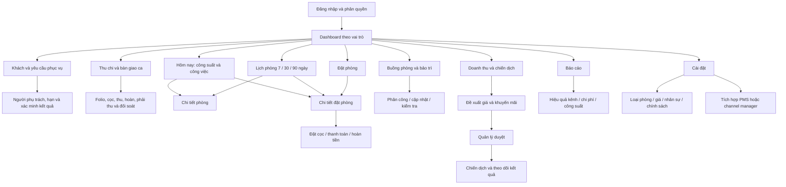
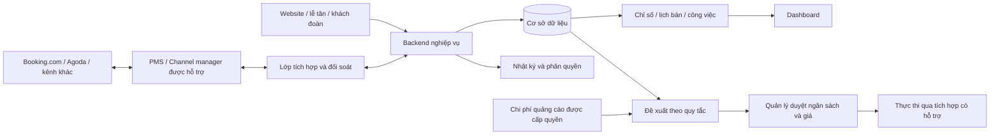

# Bản đồ sản phẩm Resort 100

**Phạm vi tham chiếu:** đây là bản đồ full PMS. Đối với kế hoạch v1 sau nghiên cứu thị trường, đọc [working summary](research/MARKET-RESEARCH-WORKING-SUMMARY.md): ưu tiên lớp Operations & Revenue Control kết nối một PMS/CM, source ownership rõ và ghi có điều kiện. Không tự triển khai mọi nhánh booking/finance như một PMS thứ hai.

## 1. Phạm vi và mục tiêu

Một cơ sở 100 phòng. Giao diện tiếng Việt, tiền VND, múi giờ cơ sở cấu hình được; bản mẫu dùng Asia/Ho_Chi_Minh. Suite/Villa/Deluxe/Standard là phân loại minh họa, cần đối chiếu danh mục thật.

Mục tiêu: biết phòng nào có thể bán và vào ngày nào, phục vụ khách đúng hạn, tối ưu lợi nhuận sau chi phí thay vì chỉ tăng công suất. Không cam kết AI sẽ lấp đầy phòng.

Đây là bản đồ sản phẩm tổng thể. Phạm vi được giao từng đợt nằm ở [IMPLEMENTATION-BRIEF](IMPLEMENTATION-BRIEF.md); chính sách còn mở ở [DECISIONS](DECISIONS.md). Xem [OPERATING-RULES](OPERATING-RULES.md) cho ngoại lệ, quyền và chỉ số. Không coi mọi nhánh sơ đồ đều thuộc PR dashboard đầu tiên.

Thiết kế toàn PMS trước khi chia đợt code: [RESORT-OPERATING-MODEL](RESORT-OPERATING-MODEL.md), [UI01–UI09](SCREEN-SPECIFICATIONS.md) và [bảng bao phủ](SCREEN-COVERAGE.md). Dashboard là một phân hệ; hồ sơ/yêu cầu khách, thu chi và bàn giao ca cũng nằm trong thiết kế tổng thể.

## 2. Bản đồ màn hình

## 3. Dashboard đầu tiên

Thứ tự ưu tiên: công việc hôm nay → phòng sẵn sàng → khoảng trống trong lịch bán → đề xuất hành động.

| Vùng | Nội dung | Hành động khi làm app thật |
| --- | --- | --- |
| Thanh trên | Cơ sở, ngày, thời điểm đồng bộ, tạo đặt phòng | Đổi ngày/cơ sở; mở form |
| Cảnh báo | Đồng bộ lỗi, khách đến nhưng phòng chưa sẵn sàng | Mở danh sách có bộ lọc |
| 4 thẻ KPI | Công suất, phòng sạch trống, trả hôm nay, công suất đã đặt D+7 | Xem nguồn số liệu |
| Công việc hôm nay | Sắp trả / sắp đến / cần dọn | Xem booking hoặc công việc |
| Biểu đồ 7 ngày | Số phòng đã đặt so với phòng có thể bán | Mở lịch đúng ngày |
| Sơ đồ 100 phòng | Trạng thái hiện tại; bộ lọc trạng thái | Mở chi tiết phòng |
| Đề xuất doanh thu | Ngày yếu, phương án, căn cứ và điều kiện | Xem đề xuất rồi duyệt |
| Hiệu quả kênh | Đêm phòng, doanh thu, hoa hồng, quảng cáo | Mở báo cáo |

Bản HTML là mẫu cho chủ resort/quản lý. Vai trò buồng phòng chỉ thấy công việc và trạng thái phòng cần thiết, không thấy doanh thu hay thông tin khách không liên quan.

## 4. Ngữ nghĩa dữ liệu — bắt buộc giữ đúng

- `Room`: phòng vật lý; `RoomType`: loại phòng. Không gộp hai khái niệm.
- `Reservation` chứa một hoặc nhiều `ReservationRoom`; mỗi dòng có loại phòng, thời gian và giá. Có thể chưa gán phòng vật lý khi mới đặt.
- Trạng thái reservation: tentative, confirmed, checked_in, checked_out, cancelled, no_show. Chỉ hold chưa hết hạn và booking hợp lệ mới giữ tồn theo chính sách.
- Danh sách trên chưa phải state machine đầy đủ: booking nhiều phòng phải có trạng thái từng dòng và tổng hợp nhận/trả/hủy một phần; thanh toán là trạng thái độc lập.
- Trạng thái housekeeping: dirty, cleaning, inspected, ready. Bảo trì là một khoảng chặn phòng riêng; trạng thái ở của khách được suy ra từ lưu trú.
- Ô phòng có nhãn hiển thị tổng hợp; dữ liệu backend vẫn tách booking, dọn phòng và bảo trì.
- Dùng khoảng lưu trú `[check_in, check_out)` để cho phép trả và nhận cùng ngày; giờ sẵn sàng thực tế còn phụ thuộc dọn phòng và chính sách.
- Ngăn xếp lịch phòng ở backend, kể cả hai nhân viên đặt cùng lúc. Khi bán theo loại phòng, kiểm tra cả tồn loại phòng và phân bổ phòng vật lý.
- Không lưu số thẻ thanh toán. Thông tin khách phải phân quyền, ghi nhật ký truy cập phù hợp và có chính sách lưu trữ.

### KPI và số liệu minh họa

100 phòng: 74 đang ở + 10 sẵn sàng + 6 chờ dọn + 4 đang dọn + 6 bảo trì = 100.

- Công suất vận hành tại thời điểm mẫu = 74 / (100 − 6 bảo trì) = **78,7%**. Đây là tỷ lệ tại thời điểm, không phải công suất đêm đã chốt sổ.
- Báo cáo theo kỳ: đêm phòng bán / đêm phòng có thể bán; cộng theo từng ngày, không lấy trung bình đơn giản của tỷ lệ.
- Phòng trống có thể nhận khách ngay: 10. Không đồng nhất với 20 phòng chưa có khách nhưng không bảo trì.
- Trả hôm nay: 12; đến hôm nay: 8. Hai số là luồng công việc, không cộng vào tổng trạng thái phòng.
- D+7: 79 / 94 = 84,0% đã đặt, giả sử 6 phòng bảo trì suốt kỳ. Là booking hiện có, không phải dự báo nhu cầu.
- ADR = doanh thu phòng / đêm phòng bán. RevPAR = doanh thu phòng / đêm phòng có thể bán. Thống nhất cách xử lý VAT, phí dịch vụ, hủy và hoàn tiền.
- Lợi nhuận đóng góp kênh = doanh thu phòng sau giảm giá − hoa hồng − chi phí quảng cáo phân bổ − chi phí biến đổi phục vụ. Đây chưa phải lợi nhuận toàn resort sau chi phí cố định.

Không suy doanh thu hoặc ROI thật từ các con số minh họa. Báo cáo kênh trong bản mẫu là một tập số liệu ví dụ độc lập theo kỳ; không dùng để đối soát với công suất tại thời điểm.

## 5. Bản đồ dữ liệu và tích hợp

Nếu đã có PMS, chọn nguồn dữ liệu chính trước khi code. Không để app mới và PMS cùng giữ hai bộ tồn phòng độc lập. Webhook cần idempotency, xử lý sự kiện đến sai thứ tự, hàng đợi retry và đối soát định kỳ. Hiển thị lần đồng bộ thành công cuối và dữ liệu trễ.

## 6. Lộ trình triển khai

1. **S0–S2 — Thiết kế và chốt phạm vi:** bản mẫu, sơ đồ, rà soát và các quyết định của đợt làm.
2. **S3 — Giao diện demo theo đợt:** S3a dashboard, S3b lịch/booking, S3c buồng phòng/bảo trì/khách, S3d thu chi/doanh thu/báo cáo/cấu hình mẫu. Thiết kế chung cả chín phân hệ trước, chia PR sau; chưa có tác động tài chính thật.
3. **S4 — Nghiệp vụ cốt lõi:** đăng nhập/phân quyền, booking, tồn phòng, dọn phòng, bảo trì, nhật ký, sao lưu và kiểm thử khôi phục.
4. **S5 — Tích hợp và chạy thử:** chọn nguồn chính; đồng bộ kênh bán; đối soát booking/tồn phòng; chạy thử có kiểm soát, một nguồn ghi chính trước khi nhận vận hành thật.
5. **S6 — Doanh thu:** giá và khuyến mãi theo quy tắc; phí kênh và chi phí phục vụ; quản lý duyệt.
6. **S7 — AI tùy chọn:** đánh giá trên dữ liệu lịch sử, đo hiệu quả tăng thêm; tự động hóa trong giới hạn có thể thu hồi.

## 7. Quyết định còn cần xác nhận trước backend

PMS/channel manager hiện tại; kênh bán; danh mục 100 phòng thật; giờ nhận/trả; chính sách giá/thuế; nguồn chi phí; vai trò nhân viên; yêu cầu dữ liệu cá nhân; nhà cung cấp hosting. Các quyết định này không chặn việc dựng giao diện mẫu.
