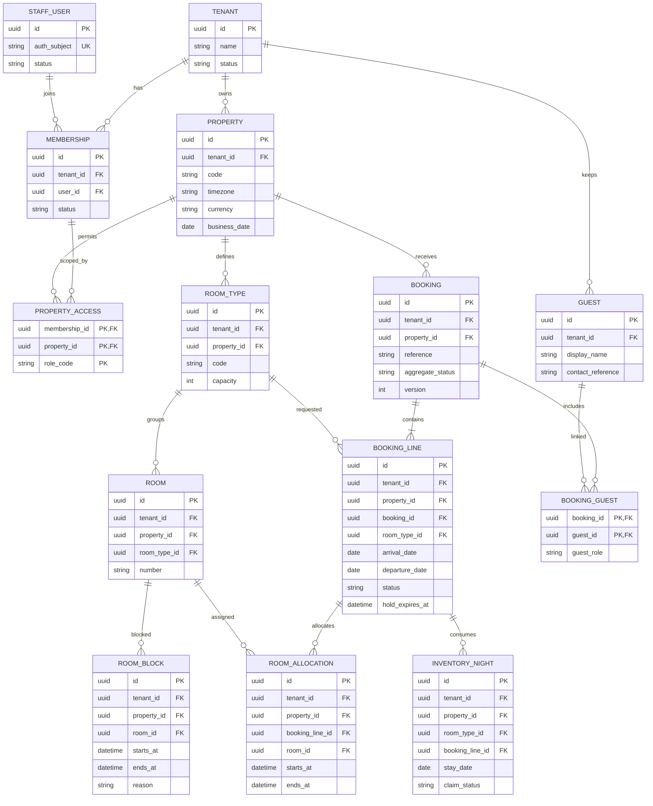

# B01 — Core ERD dự thảo

Phương án **một resort pilot, tenant-aware từ thiết kế**, chưa được chốt thay D11. `tenant_id`/`property_id` không tự bảo vệ dữ liệu. UUID/type dưới đây là đề xuất, chưa chọn database hoặc Auth provider.

## Ràng buộc phải thiết kế, không chỉ vẽ FK

- Đề xuất một BOOKING_LINE = một đơn vị phòng của một lượt ở; booking nhiều phòng có nhiều dòng. Nếu chọn quantity trên dòng thì mọi công thức/inventory phải đổi đồng bộ.
- Unique `(tenant_id, property_id, number)` cho phòng, `(tenant_id, property_id, reference)` cho booking, membership user/tenant và claim dòng/ngày theo mô hình đã chọn.
- FK xuyên bảng phải kiểm tra cùng tenant/property bằng composite constraints hoặc cơ chế tương đương; gửi ID của tenant khác không được chỉ dựa vào UUID khó đoán.
- Cặp membership/property trong PROPERTY_ACCESS phải cùng tenant; role_code tham chiếu danh mục quyền được kiểm soát. Không cho client tự thêm membership hoặc tự nhận scope.
- Guest thuộc tenant; quyền xem ở property dựa trên mục đích/lượt ở và D07, không tự mở mọi hồ sơ trong tenant cho mọi nhân viên. Liên kết BOOKING_GUEST phải cùng tenant.
- `arrival_date < departure_date` cho overnight; day-use cần thiết kế riêng trước khi hỗ trợ. Allocation có khoảng không rỗng, đúng dòng/loại và không chồng phòng theo chính sách.
- Inventory claim chỉ hiệu lực khi trạng thái và hold còn hợp lệ; nhiều lý do block cùng phòng/ngày loại trừ một lần. Cần lock/transaction phù hợp, không chỉ `SELECT COUNT` trước insert.
- Giá/thuế theo đêm, ledger, API idempotency, outbox/inbox, service/asset và audit schema chi tiết nằm trong các sơ đồ còn lại, cần physical model trước migration. Không gọi đây là ERD toàn bộ PMS đã khóa.

Nghiệm thu: TEN01/02, INV01/02/04/05/06, DATE01. Quyền của job/export/service-role cần kiểm tra như API người dùng. Dữ liệu thật không được đưa vào fixture.
