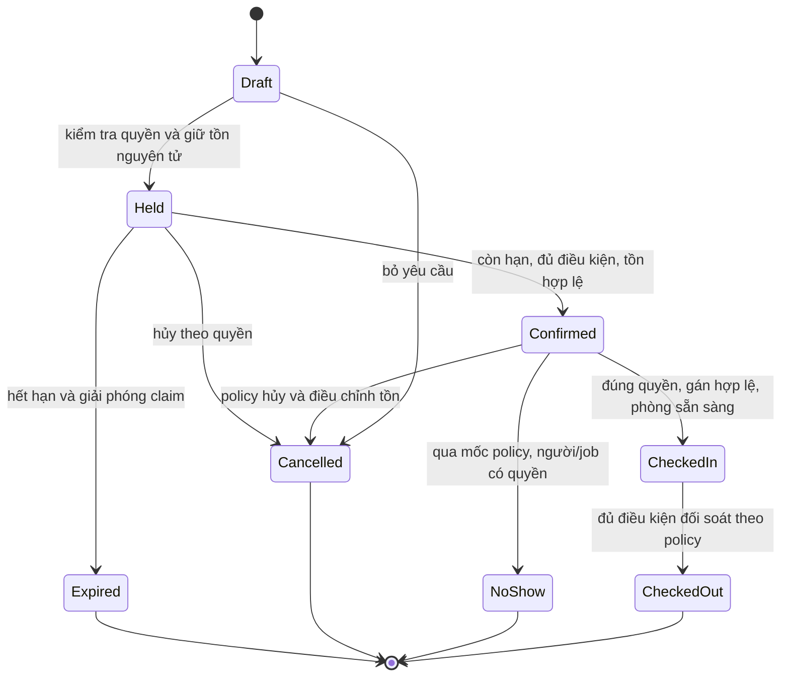
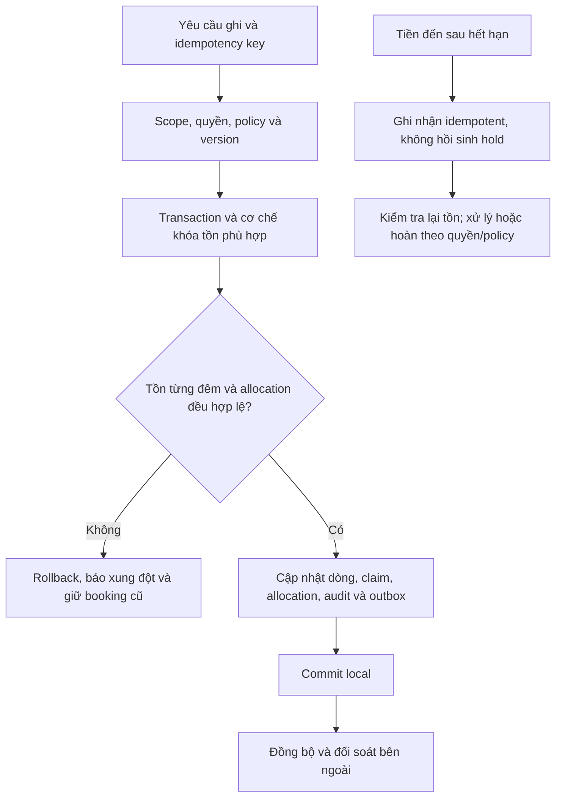

# B02 — Trạng thái từng dòng booking và tồn đêm

State machine đề xuất cho từng dòng lưu trú, không phải trạng thái tiền. Aggregate booking được suy từ các dòng, có nhận/trả/hủy một phần. Chưa chốt policy hold, cọc hoặc no-show.

Đổi/gia hạn không phải nhảy trạng thái tùy ý: preview → kiểm tra version/quyền/chính sách → lock các tài nguyên ảnh hưởng theo thứ tự ổn định → xác minh lại tồn từng đêm và gán phòng → commit cả thay đổi hoặc giữ nguyên. Thu/hoàn và API ngoài là bước riêng có trạng thái đối soát/compensation, không giả làm cùng một DB transaction.

Đề xuất không chủ động overbook. Chưa quyết định lock implementation, isolation level hoặc DB constraints cụ thể; phải chứng minh INV01 bằng test đồng thời, không bằng frontend validation. EXPIRED không tự đổi lại CONFIRMED từ webhook tiền đến muộn.
