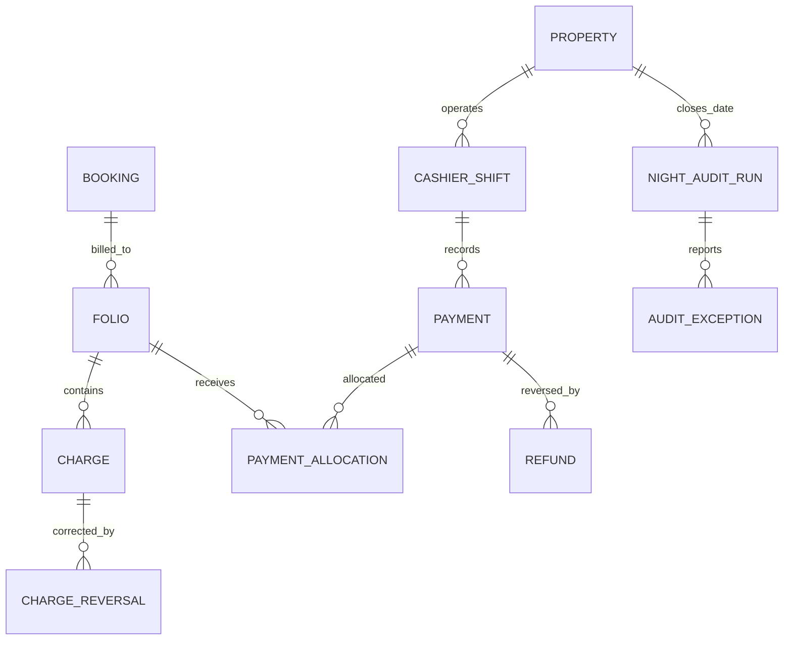
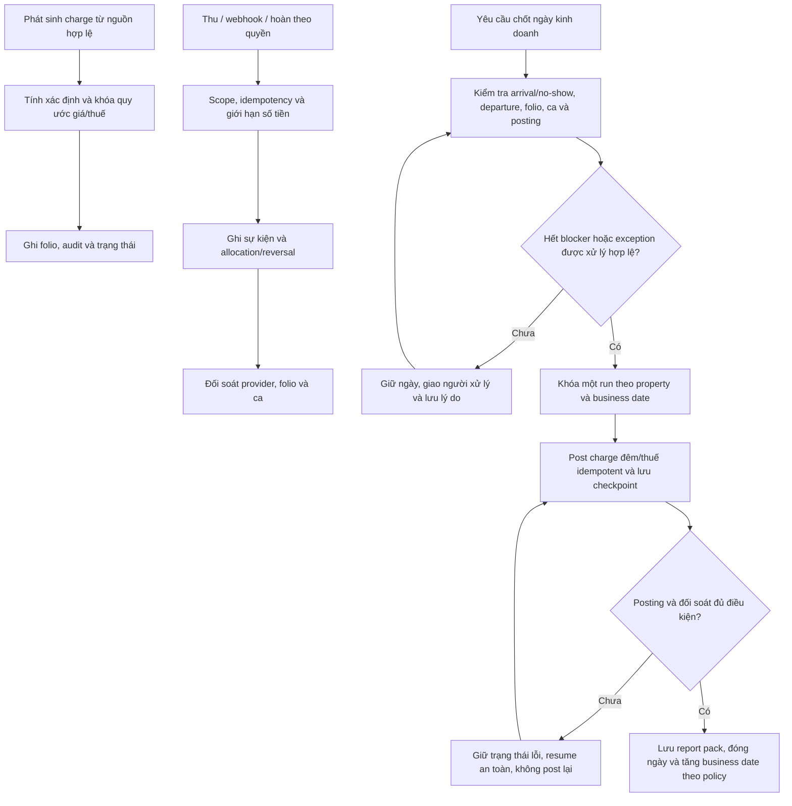

# B03 — Folio, tiền và chốt ngày

Mô hình đề xuất, chưa phải sổ kế toán hay quy tắc thuế hợp lệ đã triển khai. Chốt D06 trước physical schema và financial API.

Mọi bản ghi có ID, scope tenant/property phù hợp, trạng thái, nguồn, version/thời điểm, liên kết tới nghiệp vụ và khóa chống trùng theo provider. CHARGE giữ service/stay date, giá/thuế tại thời điểm chốt, tiền nguyên đơn vị được thống nhất hoặc decimal chính xác; PAYMENT giữ tiền thu, currency, external reference và status. Allocation hỗ trợ chia khoản nhưng không được phân bổ vượt số tiền hợp lệ; hoàn không vượt phần có thể hoàn theo lịch sử/policy. Không xóa sự kiện đã hạch toán để sửa số; dùng reversal/adjustment có quyền và lý do.

Night audit không mặc định chạy lúc 03:00, không tự trừ tiền khách và không chỉ là xuất báo cáo. Chính sách blocker/override, ca, doanh thu theo đêm, no-show, zero balance/công nợ và thời điểm chốt cần D04/D06. Job retry/restore không được tạo charge đêm hai lần. Chưa chọn chuẩn double-entry hoặc hóa đơn điện tử; nếu cần kế toán đầy đủ phải thiết kế riêng hoặc tích hợp ERP.

Nghiệm thu FIN01/02/03, INV02, DATE01, REC01.
