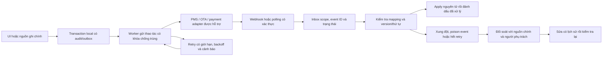

# B04 — Sync, retry và reconciliation

Đọc cùng [sơ đồ nhận sự kiện hiện có](../diagrams/08-sync-and-reconciliation.md). Chưa có provider hoặc API credentials thật; không tuyên bố OTA realtime.

Ngoài sơ đồ: ACK theo contract provider sau tiếp nhận bền vững; duplicate trả kết quả đã có, event cũ không ghi đè mới. Source ownership theo từng entity/field, mapping `(tenant, property, provider, external_id)` và khóa chống trùng có namespace. Khi provider chưa hỗ trợ idempotency, đối soát và quy tắc giới hạn retry phải tránh nhân đôi side effect.

UI hiển thị last-success, tuổi dữ liệu, queue/error và thao tác bị giới hạn. Cache cũ không mặc nhiên được dùng để bán phòng. Hoàn tác local không làm giao dịch ngoài biến mất; cần trạng thái bù trừ/đối soát. Nghiệm thu SYNC01/02, INV01/02, FIN01, TEN01.
