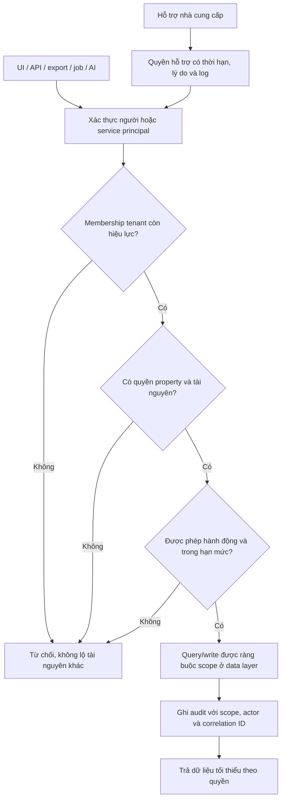

# B05 — Tenant/property/RBAC đề xuất

Phương án tenant-aware cần D11, chưa phải kiến trúc đã chọn. Trong pilot chỉ có một resort cũng phải thử hai tenant giả để chứng minh ranh giới nếu chọn phương án này.

Không tin `tenant_id` client gửi chỉ vì có trong request. Scope server lấy từ identity/membership và kiểm tra với tài nguyên. Query bằng ID vẫn phải scope; bulk, search, totals, object storage, cache key, realtime subscription và background task đều cần ranh giới tương đương. Service-role bypass không được đưa ra trình duyệt hoặc biến thành đường thoát kiểm tra quyền.

Chọn RLS nếu DB hỗ trợ không thay thế thiết kế API/policy; phải có composite scope constraints hoặc cơ chế tương đương. Chưa có quyết định shared DB/schema/site riêng. Role quản lý khách sạn không tự có quyền IT, provider admin hoặc dữ liệu tenant khác. Profile sao/gói SaaS không cấp quyền tài nguyên.

Nghiệm thu TEN01: tenant A không đọc/ghi/export/subscription dữ liệu B ở cả API và công cụ AI. TEN02: membership bị thu hồi có hiệu lực theo policy session/job; restore/import không tạo liên kết xuyên tenant.
