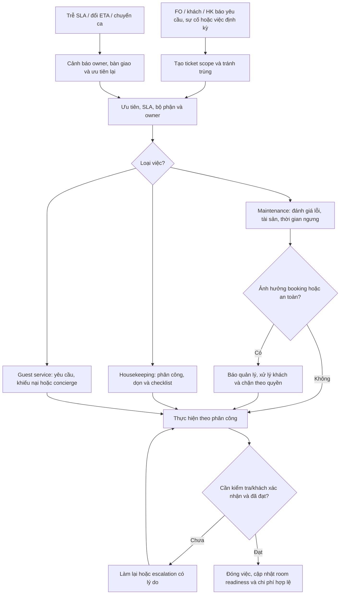

# B06 — Service desk, housekeeping và maintenance

Đề xuất mở rộng [bàn giao buồng phòng](../diagrams/12-housekeeping-handover.md). SLA, nhân sự, tài sản và quyền bồi hoàn chưa chốt.

Hoàn tất ticket không giải phóng booking đang ở. Maintenance có asset/area như hồ bơi, spa, điện nước; chặn phòng chỉ khi quan hệ ảnh hưởng và khoảng thời gian hợp lệ, không block toàn khách sạn mặc định. Vật tư/giặt là/đồng hồ/POS là nguồn tích hợp hoặc scope sau khi được chốt.

Nghiệm thu OPS01/02, MOB01/02/03, INV06. Ứng dụng nhân viên có thể responsive/mobile trước; chưa hứa offline sync hay push notification nếu chưa thiết kế lưu trữ, cache dữ liệu khách và xử lý xung đột.
