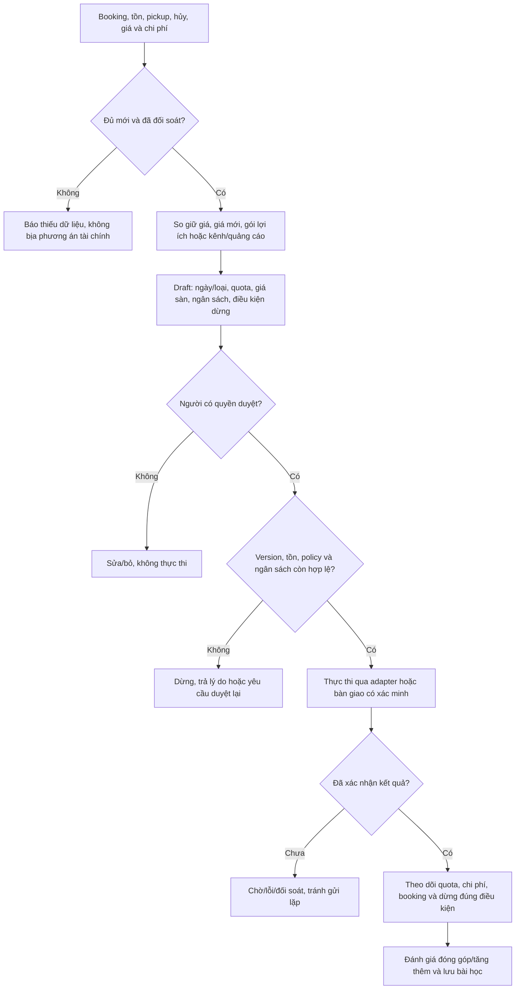

# B07 — Giá, khuyến mãi và quảng cáo

Đề xuất cho S6, không phải quyền cho phép chi tiền. Có thể vận hành rule-based trước AI; nguồn số và tính tiền là backend xác định.

State đề xuất của phương án: draft → pending_approval → approved → scheduled/applying → active → paused/ended; rejected/failed có nguyên nhân, không nhảy thẳng “active” từ bấm duyệt. Thay nội dung đã duyệt phải có revision và kiểm tra lại.

Quảng cáo được attribution không tự chứng minh tăng thêm. KPI so chi phí kênh, giảm giá, dịch vụ gói, ads và biến phí; chưa phải lợi nhuận toàn doanh nghiệp. Nghiệm thu REV01/02, SYNC01, FIN01, AUTH01.
