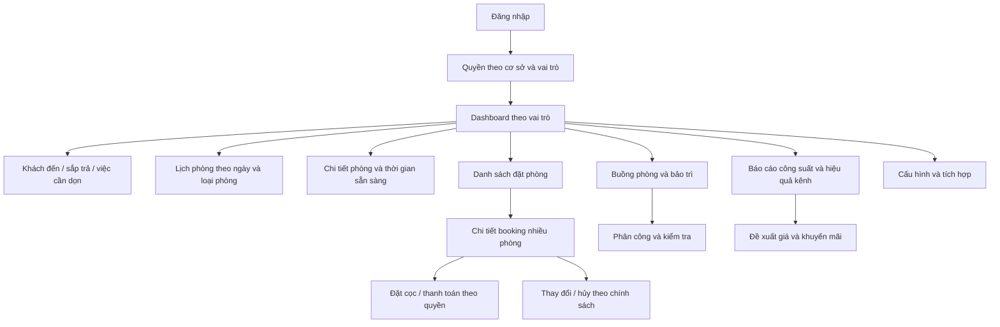

# 01 — Bản đồ màn hình

**Trạng thái:** đề xuất. Chỉ dashboard HTML mẫu đã tồn tại; các màn hình còn lại chưa được lập trình.

Dashboard quản lý không phải màn hình chung cho mọi nhân viên. Buồng phòng chỉ được xem dữ liệu phục vụ công việc; quyền cần kiểm tra tại backend. Danh sách màn hình không tự cấp quyền thao tác.

[Quay lại danh mục](README.md)
