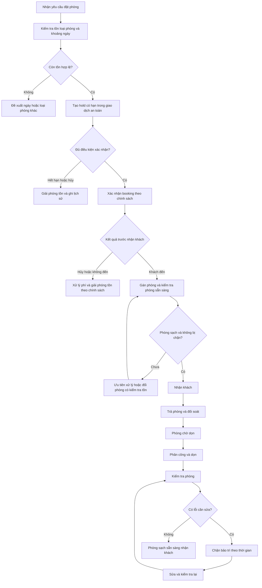

# 02 — Booking, trả phòng và sẵn sàng bán lại

**Trạng thái:** quy trình đề xuất, chưa phải chức năng đã chạy. Nhánh hủy/không đến và chính sách giữ phòng cần xác nhận với resort.

Phòng sạch chưa có nghĩa trống trong mọi ngày tương lai: vẫn phải kiểm tra booking và chặn bảo trì của khoảng ngày khách yêu cầu. Backend xử lý cập nhật tồn đồng thời; giao diện không được tự quyết định bán phòng chỉ từ trạng thái sạch.

Luồng chính chưa mô tả đổi ngày, gia hạn, hủy từng phòng hoặc thanh toán sau hold hết hạn; xem [luồng ngoại lệ bổ sung](07-booking-exceptions.md) và [quy tắc vận hành](../OPERATING-RULES.md). Chính sách và thời hạn cụ thể chưa được chốt.

[Quay lại danh mục](README.md)
