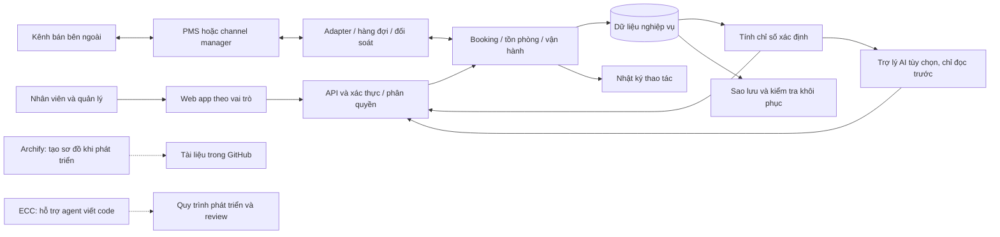

# 03 — Kiến trúc đề xuất

**Trạng thái:** khái niệm, chưa chọn backend/hosting, chưa có kết nối thật. Nếu dùng PMS hiện có làm nguồn chính, lớp nghiệp vụ và lưu trữ phải điều chỉnh theo quyền sở hữu dữ liệu đó.

Đường nét đứt là công cụ phát triển, không phải luồng phục vụ khách resort. Hello-Agents là nguồn học và tham khảo, chưa là một service trong kiến trúc. Mọi truy vấn của AI cũng phải qua dữ liệu và quyền được kiểm soát.

[Quay lại danh mục](README.md)
