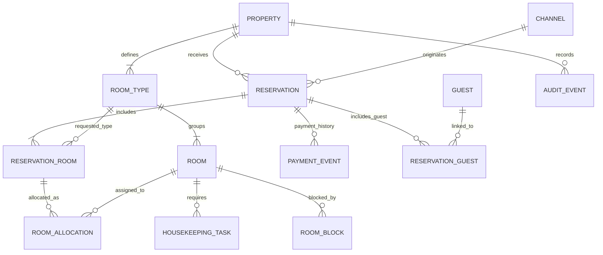

# 04 — Mô hình dữ liệu khái niệm

**Trạng thái:** đối tượng và quan hệ để thảo luận, chưa phải database schema hoặc migration hoàn chỉnh. Chưa quyết định cách lưu giá theo đêm, thuế, hoàn tiền và đối soát hệ thống ngoài.

- Một reservation có nhiều dòng phòng; dòng phòng có thể chưa gán phòng vật lý.
- `ROOM_ALLOCATION` có khoảng thời gian để hỗ trợ đổi phòng trong kỳ ở. Cần kiểm tra chồng lịch và sức chứa loại phòng trong giao dịch an toàn.
- `ROOM_BLOCK` có khoảng ngày/giờ, lý do và lịch sử; không chỉ là cờ bảo trì không thời hạn.
- `PAYMENT_EVENT` chưa chỉ định thiết kế kế toán; không lưu số thẻ thanh toán trong app.
- Quan hệ bắt buộc và ràng buộc giữa các cơ sở còn phải chốt trước migration. Chưa thể dùng ERD này để khẳng định đã ngăn bán trùng.
- Dữ liệu khách phải có phân quyền và chính sách lưu trữ. Tài khoản nhân viên, membership và quyền sẽ được thiết kế riêng trước backend.

[Quay lại danh mục](README.md)
