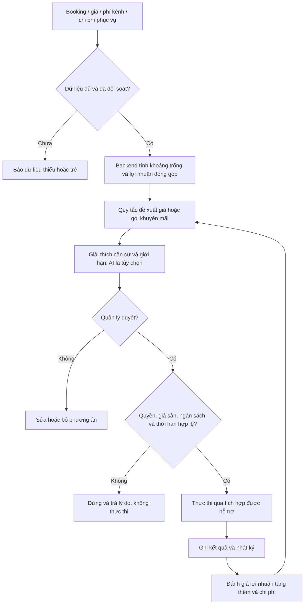

# 05 — Đề xuất doanh thu, người duyệt và AI

**Trạng thái:** kế hoạch giai đoạn sau. Chưa có dữ liệu thật, mô hình dự báo, ngân sách hoặc tích hợp quảng cáo.

Không dùng LLM làm nguồn tính tồn phòng, tiền hoặc quyết định quyền. Báo cáo attribution quảng cáo không tự chứng minh toàn bộ booking là tăng thêm. Thiết kế AI sau này cần bộ tình huống đánh giá, giới hạn chi phí và đường xử lý khi dữ liệu không đủ.

[Quay lại danh mục](README.md)
