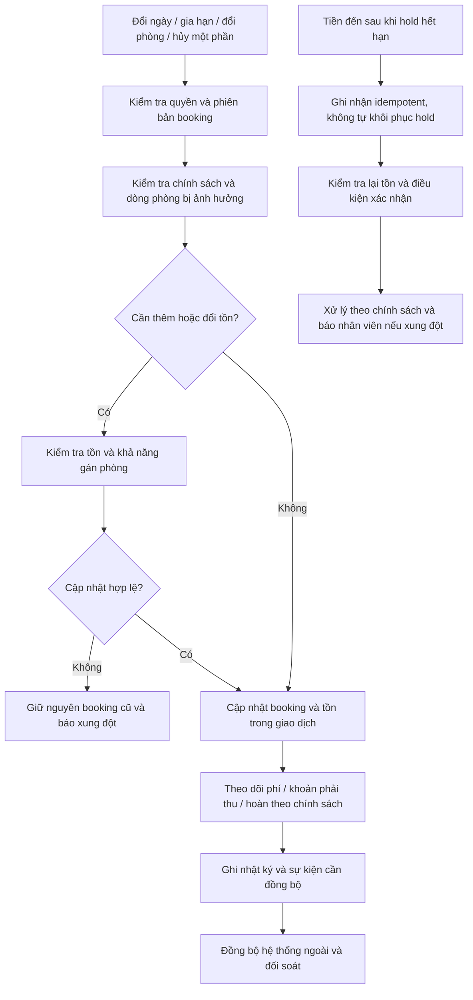

# 07 — Đổi ngày, gia hạn và hủy một phần

**Mermaid đề xuất, chưa xuất Archify; chưa có backend thực hiện luồng này.** Bổ sung cho luồng nhận/trả chính, không thay chính sách D05/D06.

Giao dịch database không làm giao dịch ngoài mạng trở thành nguyên tử. Lỗi thu/hoàn tiền hoặc cập nhật OTA cần trạng thái chờ/xử lý lỗi và đối soát; không báo mọi hệ thống thành công chỉ vì cập nhật local đạt.

[Quay lại danh mục](README.md)
