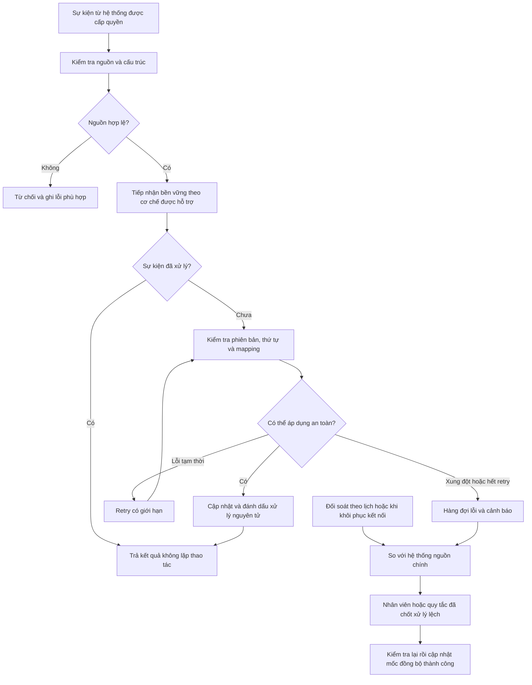

# 08 — Nhận sự kiện, chống trùng và đối soát

**Mermaid đề xuất, chưa xuất Archify.** Nhà cung cấp, API, nguồn chính và ngưỡng dữ liệu trễ chưa chọn; luồng có thể thay đổi theo D01/D02/D08.

Luồng chiều gửi ra cũng cần outbox/khóa thao tác, retry và đối soát phù hợp. Không cho cả app và PMS tự nhận là nguồn chính của cùng loại dữ liệu. Khi chưa khôi phục kết nối, UI hiển thị dữ liệu trễ và giới hạn thao tác theo chính sách; không âm thầm bán từ cache.

[Quay lại danh mục](README.md)
