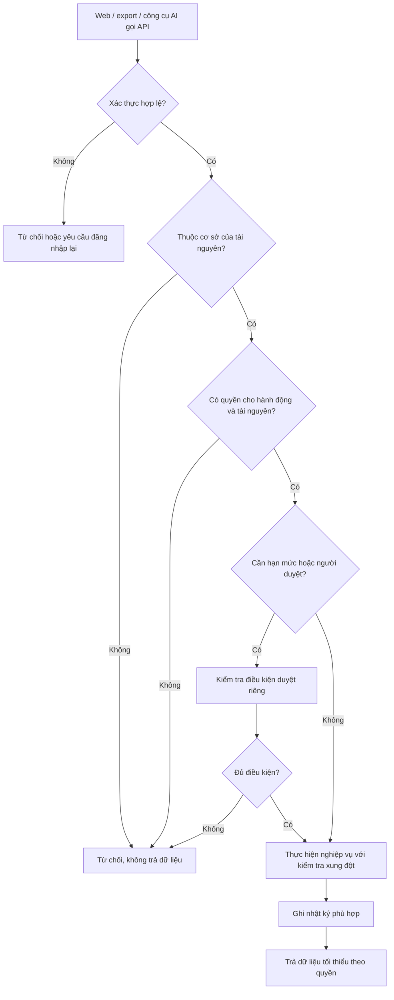

# 09 — Kiểm tra quyền tại backend

**Mermaid đề xuất, chưa xuất Archify; provider đăng nhập và quyền thực tế chưa chốt.** Xem ma trận trong [quy tắc vận hành](../OPERATING-RULES.md).

Ẩn menu hoặc có tên vai trò “quản lý” không thay thế các bước kiểm tra này. Quyền quản trị tài khoản, xem tài chính và chi quảng cáo không tự đi cùng nhau.

[Quay lại danh mục](README.md)
