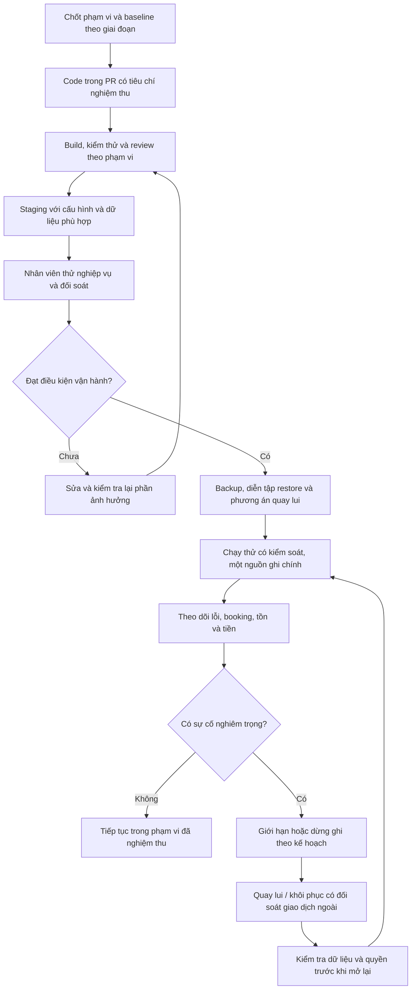

# 10 — Từ code tới chạy thử và vận hành

**Mermaid đề xuất, chưa xuất Archify.** Chưa có CI/CD, staging, production hoặc quy trình khôi phục đã thực thi.

Không đồng thời để hai hệ thống bán cùng tồn mà không có quy tắc sở hữu và đồng bộ. Không restore database rồi bỏ qua tiền hoặc booking đã phát sinh tại OTA/cổng thanh toán. Các mục tiêu RPO/RTO và người xử lý sự cố cần chốt trước production.

[Quay lại danh mục](README.md)
