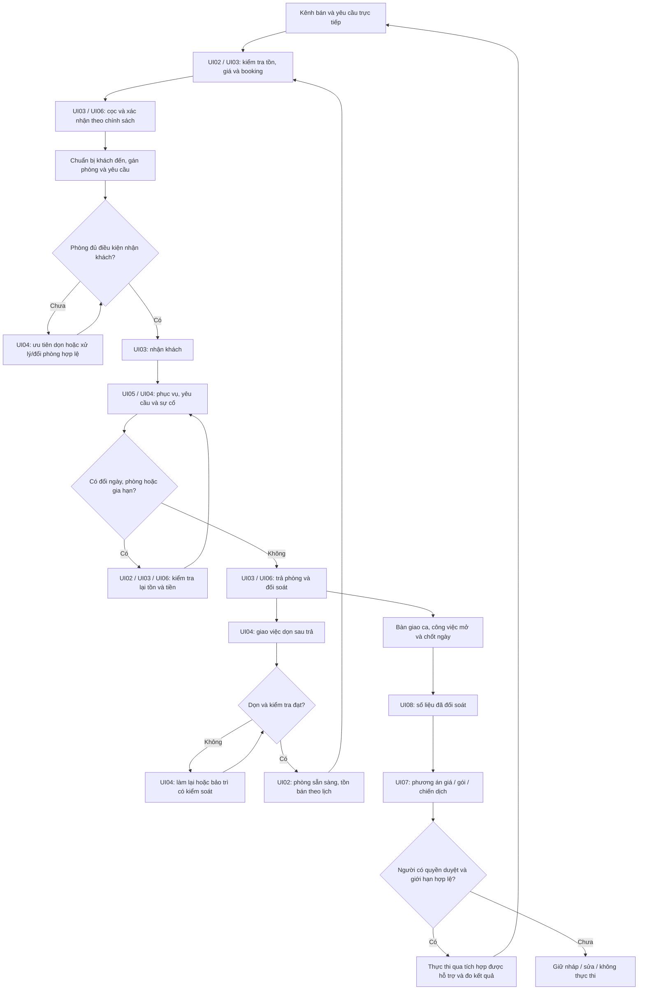

# 11 — Chu trình vận hành resort 100 phòng

**Mermaid thiết kế đề xuất, chưa xuất Archify, chưa có phần mềm thực hiện.** Xem [mô hình vận hành](../RESORT-OPERATING-MODEL.md).

UI01 là điểm tổng hợp và dẫn tới từng phân hệ, không thay các bước xử lý. UI09 giữ chính sách/quyền/nguồn dữ liệu và trạng thái kết nối cho toàn chu trình. Tồn phòng phải cập nhật qua hệ thống nguồn chính; việc quay lại nút booking không có nghĩa mọi phòng sạch đều trống mọi ngày.

[Quay lại danh mục](README.md)
