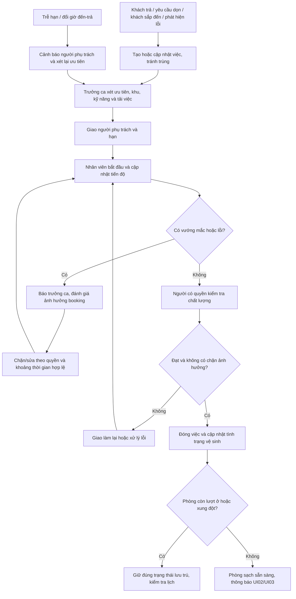

# 12 — Bàn giao lễ tân, buồng phòng và bảo trì

**Mermaid thiết kế đề xuất, chưa xuất Archify.** Trạng thái công việc và trạng thái sẵn sàng phòng là hai lớp khác nhau.

Đóng việc dọn trong kỳ ở không giải phóng phòng. Bảo trì đè booking cần xử lý xung đột trước, không tự hủy khách. Thời hạn làm việc và quyền kiểm tra chưa được chốt thành chính sách thực tế.

[Quay lại danh mục](README.md)
