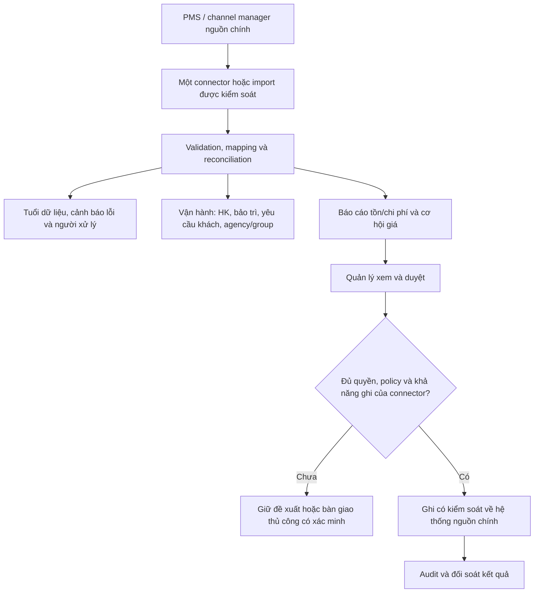

# Căn cứ làm việc — nghiên cứu thị trường BeeSmart HotelOS

Ngày tiếp nhận: 26/10/2026. Người dùng yêu cầu lưu báo cáo và dựa vào đó làm việc. [Báo cáo đầy đủ](MARKET-RESEARCH-2026-10-26.md), [bản nguyên văn](MARKET-RESEARCH-2026-10-26.raw.txt) và [sổ nguồn cần bổ sung](MARKET-RESEARCH-SOURCE-REGISTER.md) được giữ riêng để truy nguyên.

**Trạng thái:** tài liệu tham chiếu chính cho định vị và lập kế hoạch tiếp theo. Không có phỏng vấn/WTP/pilot thật được cung cấp; chưa khóa giá, provider, API hoặc baseline triển khai. Codex đã đọc và lưu, chưa kiểm tra độc lập các nguồn web trong báo cáo.

## 1. Hướng lập kế hoạch ưu tiên

BeeSmart HotelOS v1 theo khuyến nghị nghiên cứu: **Hotel Operations & Revenue Control Layer** cho khách sạn/resort độc lập, kết nối PMS/channel manager hiện có. Pilot một resort khoảng 100 phòng, một nguồn booking/tồn chính, một connector trước. Phân khúc thử nghiệm được thu hẹp trong báo cáo về khoảng 50–150 phòng tại Việt Nam, có nhiều kênh và nhu cầu ops/agency; chưa phải ICP đã được thị trường xác thực.

Lý do được nêu: giảm gánh migration và rủi ro thay FO/finance/night audit; ưu tiên dữ liệu được đối soát, công việc xuyên bộ phận, booking đoàn/agency và hiệu quả sau chi phí. Tính năng AI/mobile/pricing đơn lẻ chưa được chứng minh là lợi thế khác biệt.

Đây là căn cứ ưu tiên backlog và discovery, không tự chốt D01/D02/D11 hoặc chứng minh resort pilot đang có một PMS cụ thể. Nếu thực tế không có nguồn dữ liệu truy cập được, phải quay lại quyết định phạm vi thay vì tạo một bản PMS ngầm song song.

## 2. Luồng v1 để thiết kế tiếp

Đường ghi là giai đoạn sau, không tự bật từ việc đọc tài liệu. Read-only về booking/tồn vẫn cho phép BeeSmart quản lý task nội bộ nếu đã chốt ownership. Trạng thái “phòng sẵn sàng” tại BeeSmart cần phân biệt dữ liệu công việc, kết quả QA, và mốc PMS đã nhận/xác nhận; không báo đã đồng bộ chỉ vì nhân viên bấm hoàn tất.

## 3. Phạm vi ưu tiên và phần để sau

| Chủ đề | Ưu tiên theo báo cáo | Không tự đưa vào v1 |
| --- | --- | --- |
| Dữ liệu | 1 PMS/CM connector, CSV fallback, mapping/validation/reconciliation | Nối nhiều PMS hoặc direct OTA certification cùng lúc |
| Booking/tồn | Đọc và đối soát; workflow ghi chỉ theo API/quyền nguồn chính | Tạo bộ inventory hoặc channel manager song song |
| Ops | HK mobile, maintenance ticket/ảnh hưởng phòng, guest request/SLA/owner | Full workforce management, CMMS/ERP/kho toàn diện |
| Agency/group | Hợp đồng/giá, block/allotment, release, rooming list và đối soát cần thiết | Tự giữ allotment ngoài PMS khi không có quyền/khả năng đồng bộ |
| Finance | Đọc/tổng hợp/đối soát tiền, công nợ và settlement | Thay sổ cái, payment processor hoặc night audit của PMS |
| Revenue | Rule-based recommendation, nguồn chi phí, floor/ceiling và người duyệt | Giá tự động không kiểm soát hoặc tự chi quảng cáo |
| AI | Giải thích/tóm tắt/hỗ trợ đọc dữ liệu theo quyền | Làm nguồn tính tồn/tiền hoặc tự quyết tài chính |
| SaaS | Thiết kế ranh giới cần thiết cho pilot theo D11 | Billing/portfolio/superadmin cho hàng trăm khách khi chưa chốt |

## 4. Ảnh hưởng tới bộ thiết kế đang có

Giữ nguyên chín phân hệ UI01–UI09, Figma, wireframe, bảy blueprint và ERD như **thư viện thiết kế tổng thể**, chưa bỏ hoặc tự code toàn bộ.

- UI02/UI03: trước mắt thể hiện dữ liệu PMS, tuổi dữ liệu và chênh lệch. Tạo/đổi/gia hạn/hủy/nhận-trả chỉ thực hiện qua nguồn chính nếu đã có contract/quyền; nếu chưa thì bàn giao, không ghi một booking local rồi coi là xác nhận thật.
- UI04/UI05: ưu tiên luồng task/QA/owner/SLA; mapping trạng thái về PMS và quyền chặn phòng cần thiết kế rõ.
- UI06: ưu tiên đối soát và visibility; các form thu/hoàn/night audit trong wireframe là khái niệm tham chiếu, không phải scope write mặc định.
- UI07: ưu tiên giá/gói được đề xuất, người duyệt, audit và execution reconciliation. Ads báo cáo/read-only để sau theo khuyến nghị; chưa có ngân sách được cấp.
- UI08/UI09: tăng ưu tiên nguồn/công thức, độ mới dữ liệu, mapping, connector health và quyền.

S3a–S3d trong tài liệu cũ mô tả chia khối lượng demo toàn PMS. Trước khi giao code sản phẩm theo nghiên cứu, phải chốt scope pilot mới và adapter capabilities, không tự triển khai toàn bộ hành động ghi trong prototype.

## 5. Discovery và lộ trình pilot đề xuất

1. Xác định PMS/CM thật, kênh, dữ liệu, quyền truy cập, room/rate map, quy trình agency và nhân sự; lập data dictionary + source ownership.
2. Đo baseline từ quan sát/log: nhập lặp, thời gian phòng sẵn sàng, lỗi trạng thái, xử lý yêu cầu, thời gian booking đoàn, chi phí support.
3. Read-only/import → đối soát critical records → cảnh báo dữ liệu trễ và người xử lý.
4. Vận hành HK/maintenance/guest service; thử một hành trình đoàn/agency từ request đến rooming list và đối soát.
5. Revenue recommendation có căn cứ; controlled write chỉ khi gate và API/quyền cho phép.
6. Đánh giá adoption, hiệu quả công việc, dữ liệu, cost-to-serve và WTP để go/pivot/stop.

Báo cáo đề xuất pilot **8–12 tuần vận hành**; đây không phải deadline code hoặc cam kết đã được chốt. Không tự nhận lời tăng doanh thu, causal ROI hoặc giá bán từ một pilot ngắn có nhiều yếu tố mùa vụ/kênh.

## 6. Các con số cần giữ đúng loại

- Giá Figma 1,49/3,49/6,99 triệu và giá Ops/Connect/Revenue trong nghiên cứu đều là giả thuyết, chưa phải price list. Báo cáo đề xuất thử Connect 4,9 triệu hoặc Revenue 6,9 triệu/tháng cho pilot, nhưng chưa có WTP/báo giá được chấp nhận.
- Chi phí giờ công, tỷ giá kế hoạch, token/hosting và support là cost model cần cập nhật bằng báo giá/usage thật; không cấu hình billing từ chúng.
- Gate như 100% critical booking records đối soát, 0 double-booking do BeeSmart, 95% cập nhật trong SLA, 80% adoption, 30% cải thiện workflow, 4 giờ support/tháng là **ngưỡng thử nghiệm được đề xuất**, chưa là benchmark ngành/SLA hợp đồng hoặc kết quả đạt.
- Số thị trường, giá và tính năng vendor cần URL/quote/phiên bản để kiểm tra; bản nguyên văn hiện không có URL. Không nâng chúng thành bằng chứng độc lập trong tài liệu sales.

## 7. Cách sử dụng từ phiên sau

Agent đọc file này trước khi đề xuất backlog, API/schema hoặc sửa thiết kế v1; đọc báo cáo đầy đủ khi cần bối cảnh/số liệu. Ghi rõ điều nào là recommendation, assumption, quote/vendor claim hoặc observed pilot result. Các xung đột về scope/ownership phải được ghi ở DECISIONS, không âm thầm biến prototype PMS đầy đủ thành code v1.

Người dùng đã yêu cầu dùng nghiên cứu làm căn cứ làm việc; không cần hỏi lại việc lưu/đọc tài liệu. Những quyết định còn thiếu dữ liệu thực tế vẫn được giữ mở. Chưa giao việc cho agent khác hoặc bắt đầu backend từ việc lưu báo cáo.
